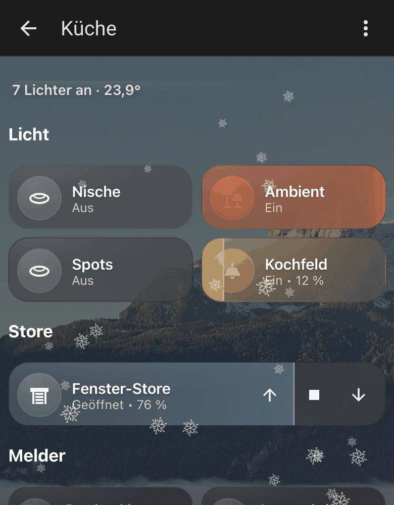
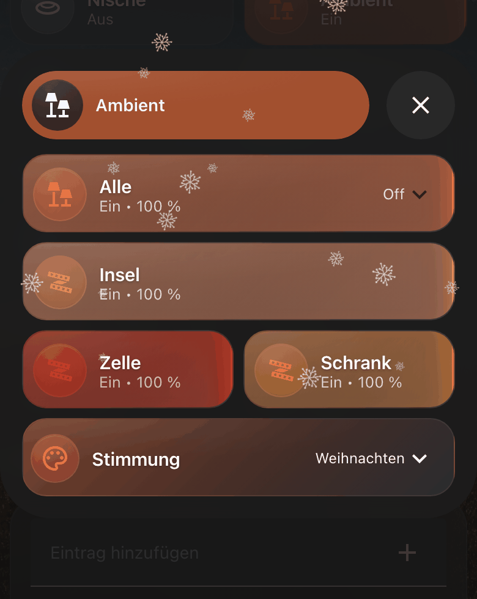

# Einbauen

Du brauchst aus dem Marketplace: **Bubble Card** und **card-mod**.

1. `themes/liquid_glas.yaml` nach `/config/themes/` kopieren. In der `configuration.yaml`:
   ```yaml
   frontend:
     themes: !include_dir_merge_named themes/
   ```
   Danach die Aktion `frontend.reload_themes` ausführen und im Profil „Liquid Glas“ wählen.

2. `www/bubble/bubble-modules.yaml` nach `/config/www/bubble/` kopieren. Bubble Card findet die Module dort von selbst.

3. `www/zuhause/` nach `/config/www/zuhause/` kopieren (Hintergründe).

4. Dashboard anlegen → Bearbeiten → ⋮ → Raw-Konfigurationseditor → Inhalt von `dashboard/beispiel-raum.yaml` einfügen.

5. Die Entitäten (`light.kueche_spots` usw.) durch deine ersetzen. Die Lampen für Ambient fasst du vorher als Lichtgruppe zusammen (Einstellungen → Helfer → Gruppe → Licht).

So sieht es danach aus:

<p>
  
  
</p>

Tipp: Das Symbol stellst du an der Entität ein, nicht an der Karte. Dann stimmt es überall.
