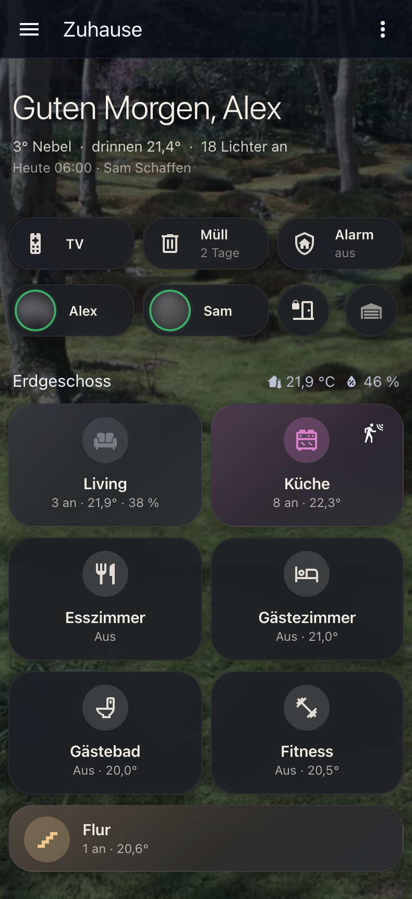
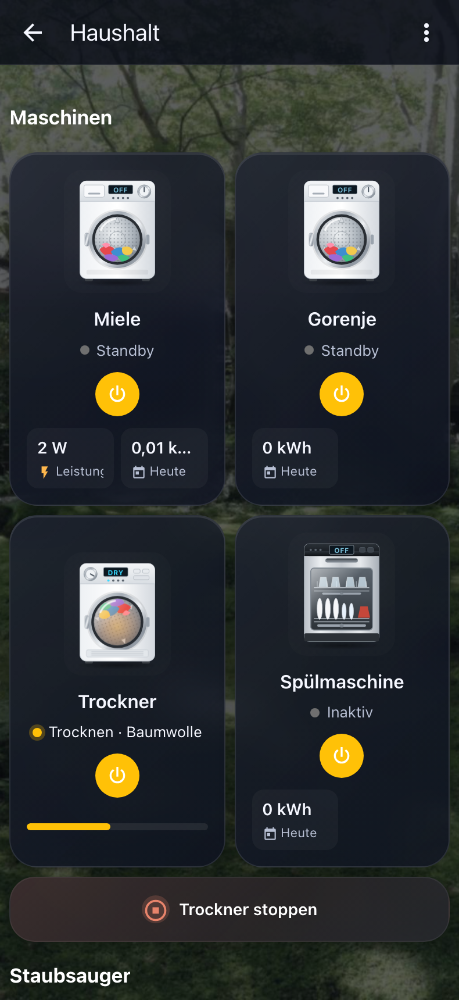
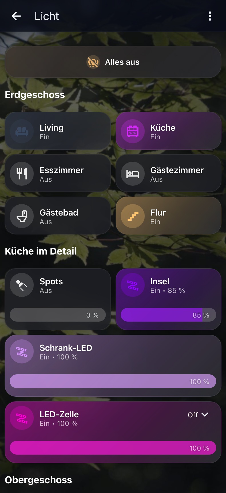
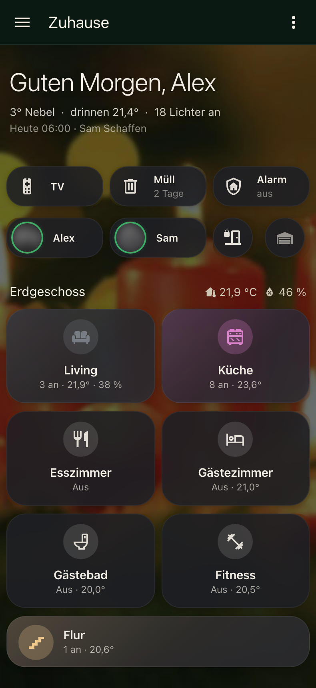
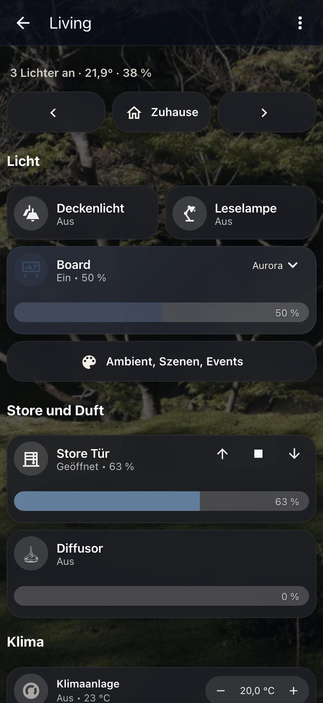
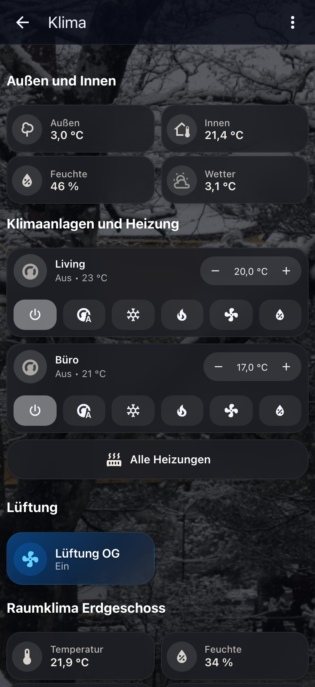

# Liquid Home

Mein Home-Assistant-Dashboard. Ich wollte etwas Ruhiges: Naturfotos im Hintergrund, die Karten darüber leicht durchscheinend, und Farbe nur da, wo gerade etwas passiert. Wenn in der Küche das Licht lila ist, ist die Kachel Küche auch lila. Läuft die Waschmaschine, sieht man das sofort.

Für die Feiertage gibt es eigene Themes: Weihnachten, Silvester, Ostern und Halloween.

<p>
  
  
  
  
</p>
<p>
  
  
</p>

## Was drin ist

- `dashboard/liquid-home.yaml`: das ganze Dashboard, 32 Seiten (Start, alle Räume, Haushalt, Licht, Klima, Media, Alarm und so weiter)
- `themes/liquid_home.yaml`: das Theme, hell und dunkel
- `themes/fest.yaml`: die vier Fest-Themes
- `www/zuhause/`: die Hintergrundbilder
- `werkzeuge/theme_fest.py`: daraus entsteht `fest.yaml`. Wer andere Farben will, ändert sie dort und lässt das Skript einmal laufen.

## Diese Karten braucht ihr

- [Bubble Card](https://github.com/Clooos/Bubble-Card), fast alles im Dashboard ist damit gebaut
- [card-mod](https://github.com/thomasloven/lovelace-card-mod), für den Glas-Effekt
- [Universal Remote Card](https://github.com/Nerwyn/universal-remote-card), für die Fernbedienungen
- [Appliance Cards](https://github.com/skyrotter/ha-appliance-electromenager-cards), für Waschmaschine, Trockner, Spülmaschine und Saugroboter
- Love Lock Card, nur für die PIN-Seite der Garage

## Einrichten

1. Die beiden Dateien aus `themes/` nach `/config/themes/` kopieren. In der `configuration.yaml` braucht es dafür:
   ```yaml
   frontend:
     themes: !include_dir_merge_named themes/
   ```
   Dann unter Entwicklerwerkzeuge die Aktion `frontend.reload_themes` ausführen.
2. Den Ordner `www/zuhause/` nach `/config/www/zuhause/` kopieren. Falls es `/config/www` vorher nicht gab, Home Assistant einmal neu starten.
3. Ein neues Dashboard anlegen, auf Bearbeiten gehen, oben rechts ⋮ → Raw-Konfigurationseditor, und den Inhalt von `dashboard/liquid-home.yaml` einfügen.
4. Jetzt kommt die eigentliche Arbeit: Die Entitäten sind die aus meinem Haus. Die müsst ihr durch eure ersetzen. Die Personen heißen hier Alex, Sam, Kind 1 und Kind 2.

## Gut zu wissen

Jede Seite hat ihr eigenes Theme und Foto. Wenn ihr im Profil ein Fest-Theme auswählt, ändert sich deshalb nur die Kopfleiste. Für die volle Weihnachtsstimmung bei den Seiten `theme: Fest Weihnachten` eintragen und eins der `xmas_*.jpg` als Hintergrund nehmen.

Die Statusleiste in der Android-App nimmt ihre Farbe aus `app-header-background-color`. Steht dort ein achtstelliger Wert wie `#0A1A13CC`, liest die App ihn falsch herum und die Leiste wird lila. Deshalb stehen in den Themes nur sechsstellige Farben.

Die Love Lock Card prüft den PIN nur im Browser. Wer den Dashboard-Code lesen kann, sieht ihn. Für das Garagentor oder die Alarmanlage ist das keine echte Sicherung. Im Beispiel steht `1234`.

## Lizenz

Dashboard, Themes und Skript: MIT. Die Fotos sind von Wikimedia Commons und haben ihre eigenen Lizenzen, die stehen mit Urheber in `www/zuhause/QUELLEN.md`.
