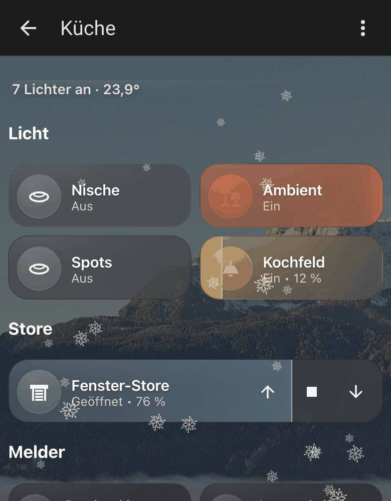
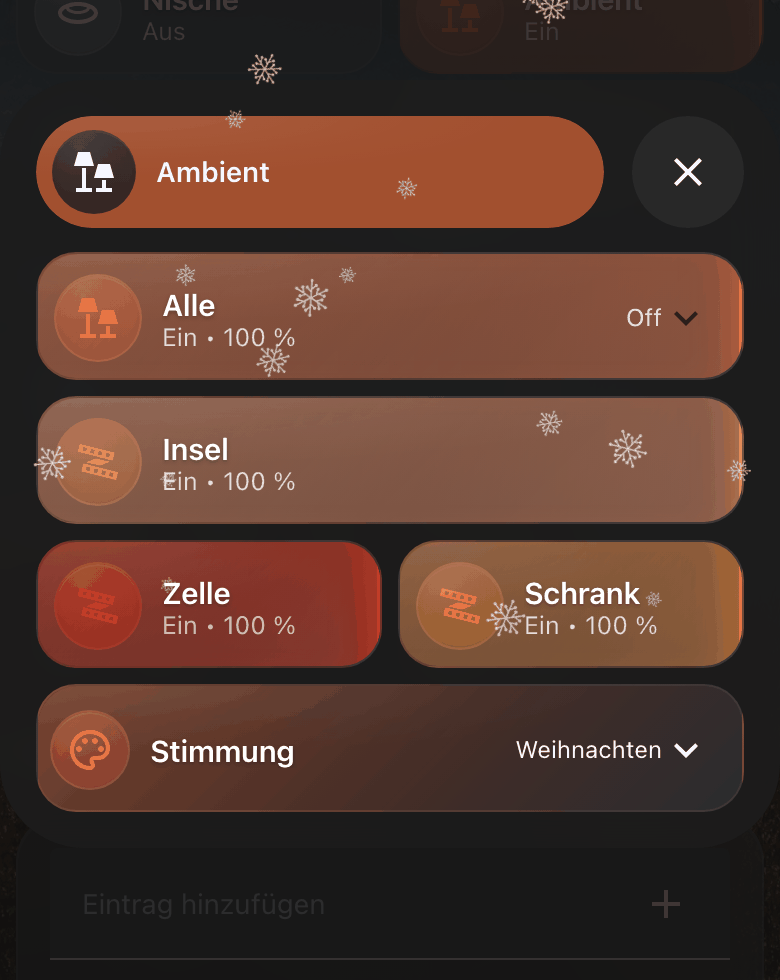
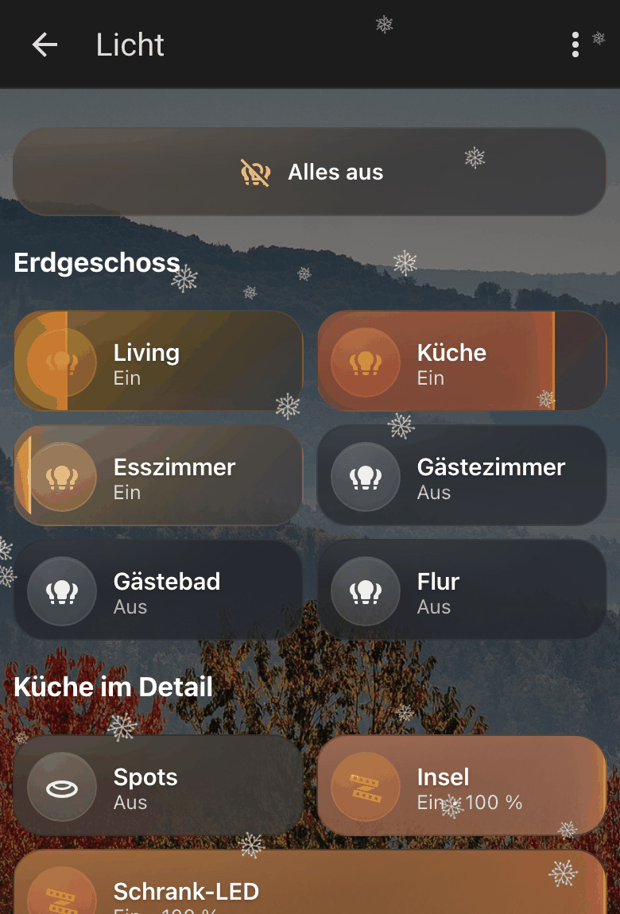
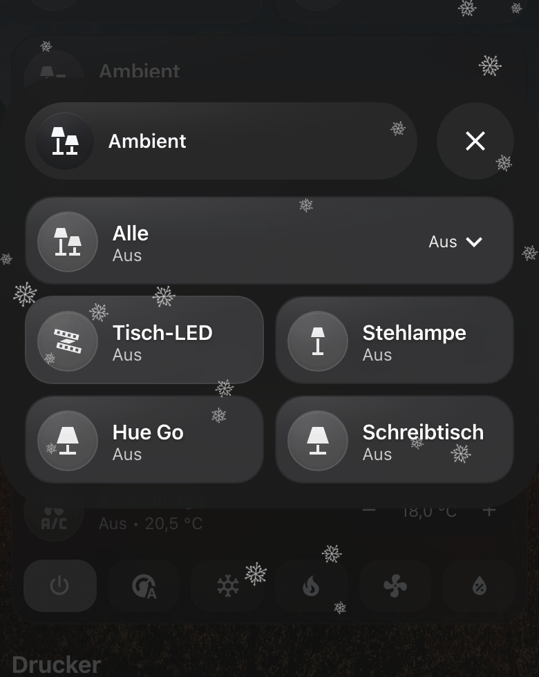
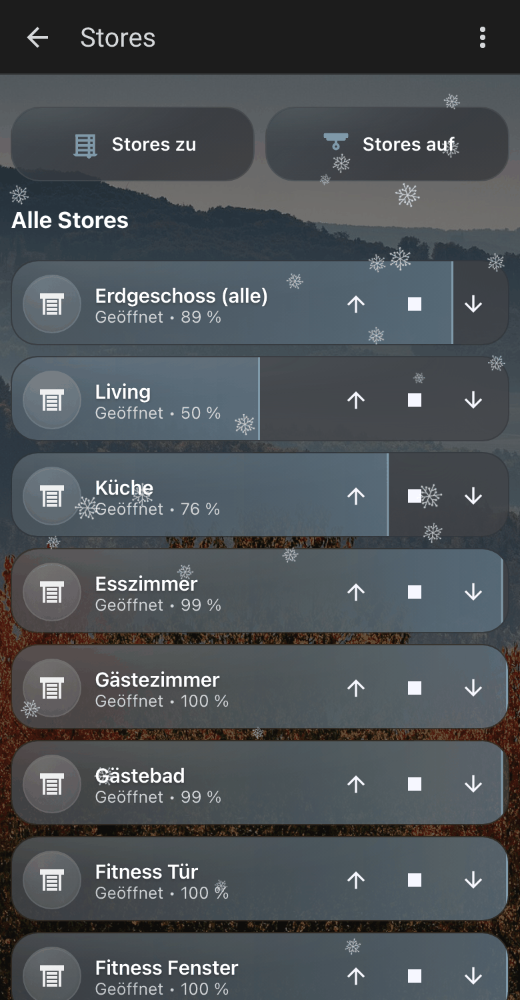

# Liquid Home · Liquid Glas

Ein Home-Assistant-Dashboard von **Ivo Marques**.

Liquid Glas ist mein Design-Standard dafür: dunkles, ruhiges Glas über Naturfotos, Farbe nur dort, wo etwas an ist, und jeder Raum nach demselben Muster. Das Dashboard ist für die ganze Familie gedacht, also auch für Leute, die sich nie mit Home Assistant beschäftigen. Deshalb habe ich lieber Dinge weggelassen als neue dazugebaut.

  
  
  

  
  

Einbauen: siehe [EINBAUEN.md](EINBAUEN.md).

## Der Standard

### Ein Raum ist immer gleich aufgebaut

- Oben das Hauptlicht (Deckenlicht, Spots).
- Daneben **eine** Kachel „Ambient“. Das ist eine Lichtgruppe mit allen LEDs und Deko-Lampen im Raum.
- Antippen von Ambient öffnet ein Pop-up in der Bildmitte. Darin steht oben die Gruppe („Alle“), darunter die einzelnen Lampen paarweise, ganz unten Extras wie eine Stimmungs-Auswahl.
- Auf der Kachel wischen dimmt direkt, ohne Pop-up.

**Warum:** Vorher standen in der Küche neun Lampen-Kacheln, darunter „Zelle“, „Insel links“ und „Insel rechts“. Niemand außer mir wusste, was das ist. Jetzt sieht man vier Kacheln, der Rest ist einen Fingertipp entfernt. Was man nie einzeln schaltet, zum Beispiel die linke und rechte Schreibtischlampe, ist eine Gruppe und erscheint als eine Kachel.

### Größen und Abstände

- Jede normale Kachel ist **64 px** hoch, egal ob Schalter, Dimmer oder Automation.
- Kacheln stehen paarweise in zwei Spalten. Bei einer ungeraden Anzahl bekommt die erste die volle Breite.
- Im Pop-up haben alle Kacheln `rows: auto`, so bleiben die Abstände überall gleich.

**Warum:** Es gab vorher vier verschiedene Höhen (52, 64, 66 px und ohne Angabe). Das sieht man nicht bewusst, aber es wirkt unruhig.

### Namen

- Auf der Kachel steht nur die Funktion: „Spots“, „Kochfeld“, „Ambient“. Der Raum steht schon oben auf der Seite.
- Die Entität heißt „Raum Funktion“, zum Beispiel `Küche Spots`. Kurz, ohne Zahlen, ohne englische Technikwörter.
- Keine Kürzel wie EG/OG auf den Kacheln. Wo man unterscheiden muss, steht „oben“ oder „unten“.
- Beim Umbenennen bleibt der alte Name als Alias stehen, damit Sprachbefehle weiter funktionieren. Die `entity_id` ändere ich nie, sonst brechen Automationen.

**Warum:** Namen wie „Linus Licht Licht Linus Zimmer“ oder „Wärmepumpe Wärmepumpe – Hochdruck“ entstehen, wenn Gerätename und Entitätsname einfach zusammengeklebt werden. Für jemanden, der das Dashboard nur bedient, ist das nur verwirrend.

### Symbole

Das Symbol hängt an der Entität, nicht an der Karte. So ist es in jedem Dashboard dasselbe.

| Art | Symbol |
|---|---|
| Deckenlicht | `mdi:ceiling-light` |
| Spots | `mdi:light-recessed` |
| LED-Streifen | `mdi:led-strip-variant` |
| Ambient (Gruppe) | `mdi:lamps` |
| Tischlampe | `mdi:lamp` |
| Stehlampe | `mdi:floor-lamp` |
| Nachtlicht | `mdi:lightbulb-night` |
| Steckdose | `mdi:power-socket-de` |
| Außenlicht | `mdi:outdoor-lamp` |
| Lüster | `mdi:chandelier` |

In den runden Chips oben steht das Symbol ohne eigenen Kreis. Kreis in einer runden Pille sah billig aus.

### Farben

Eine Farbe pro Bedeutung, alle gedämpft. Vorher waren es 55 verschiedene Töne, darunter das grelle iOS-Blau, -Grün und -Rot.

| Bedeutung | Farbe (RGB) |
|---|---|
| Licht an | 255, 196, 110 |
| Stores, Wasser | 126, 170, 196 |
| Automationen | 110, 200, 190 |
| Gut, läuft | 125, 190, 145 |
| Achtung | 232, 194, 122 |
| Gefahr | 232, 132, 107 |
| Heizen | 201, 150, 112 |
| Kühlen | 140, 168, 186 |
| Szenen, Medien | 160, 140, 205 |

Ist eine Lampe an, nimmt die Kachel ihre echte Lichtfarbe an, leicht und als Verlauf. Dazu kommt je Etage ein Pastellhauch am Rand: Pfirsich unten, Himmelblau oben, Salbei für Keller und Garten.

### Glas

- Karten: dunkles Glas `rgba(30,31,36,0.62)`, Blur 20–26 px, Sättigung 115 %, dünner heller Rand.
- Das Glas steht zentral in Bubble-Card-Modulen (`www/bubble/bubble-modules.yaml`) und nicht in jeder einzelnen Karte. Das Modul `default` gilt für alle Bubble-Karten, die Karten binden dazu `zg_glas` oder die Etagen-Variante ein.
- Schalter- und Dimm-Kacheln sehen gleich hell aus. Das musste ich nachmessen: Schalter waren vorher deutlich dunkler, weil ihnen die Reglerschicht fehlt.

### Was ein Update überleben soll

- Pop-ups nutzen nur offizielle Bubble-Card-Optionen: `popup_mode: centered` und `full_width_on_mobile: true`.
- Nur Karten aus dem Home-Assistant-Marketplace, keine selbst geschriebenen.
- Das eigene CSS steckt in benannten Blöcken (`/* glas-gleich */ … /* glas-gleich-ende */`). So lässt es sich gezielt austauschen oder entfernen.
- Nach einem größeren Bubble-Card-Update schaue ich einmal über die Seiten. Die CSS-Klassen können sich ändern.

## Dateien

| Datei | Inhalt |
|---|---|
| `themes/liquid_glas.yaml` | Theme Liquid Glas (hell und dunkel) |
| `www/bubble/bubble-modules.yaml` | Glas-Module für Bubble Card |
| `dashboard/beispiel-raum.yaml` | ein vollständiger Raum nach dem Standard (Küche): Licht, Ambient mit Pop-up, Store, Melder, Einkaufsliste |
| `dashboard/beispiel-chip.yaml` | ein Chip für die Startseite |
| `themes/liquid_home.yaml`, `themes/fest.yaml`, `dashboard/liquid-home.yaml` | die erste Fassung vom 9. November 2026 mit Fest-Themes |
| `www/zuhause/` | Hintergrundfotos (Wikimedia Commons, Quellen in `QUELLEN.md`) |

## Lizenz

Dashboard, Themes, Module und Skript: MIT, © 2026 Ivo Marques. Die Fotos haben ihre eigenen Lizenzen, siehe `www/zuhause/QUELLEN.md`.
